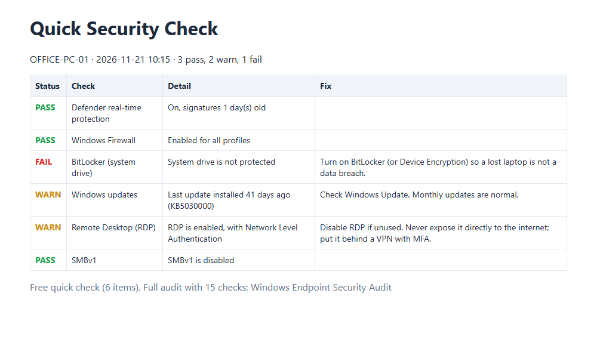

# Windows Quick Security Check (free PowerShell script)

A free, **read-only** PowerShell script that checks the six Windows security basics cyber insurers, clients and IT auditors ask about most. It prints PASS / WARN / FAIL with a plain-English fix for anything that needs attention. With `-Html`, it also saves a simple HTML report.



## What it checks

| # | Check | Why it matters |
|---|-------|----------------|
| 1 | Microsoft Defender real-time protection and signature age | Antivirus that is off or out of date misses common malware |
| 2 | Windows Firewall (all profiles) | A disabled firewall exposes services to the network |
| 3 | BitLocker on the system drive | An unencrypted lost laptop can become a reportable data breach |
| 4 | Days since the last installed update | Unpatched PCs are the easiest way in |
| 5 | Remote Desktop (RDP) and Network Level Authentication | Exposed RDP is a top ransomware entry point |
| 6 | SMBv1 | An obsolete protocol abused by WannaCry |

It makes **no changes** to the computer. Read the script before running it. It's short and commented.

## Run it

```powershell
# In an elevated PowerShell window (Run as administrator) for complete results:
Set-ExecutionPolicy -Scope Process Bypass
.\Invoke-QuickSecurityCheck.ps1          # console output
.\Invoke-QuickSecurityCheck.ps1 -Html    # also saves an HTML report next to the script
```

Works with Windows PowerShell 5.1 on Windows 10 and 11. Without admin rights, a few checks (such as BitLocker) show WARN instead of a result.

## Want the full audit?

The paid **[Windows Endpoint Security Audit](https://toddler644.gumroad.com/l/ebylvl)** ($24) runs 15 checks with a color-coded HTML report. It adds local administrators and the Guest account, pending reboot, UAC, screen lock policy, PowerShell v2, and listening ports, plus 4 bonus read-only scripts (software inventory, startup items and scheduled tasks, failed logons, share permissions). It's useful for onboarding a new client or after an incident.

*Disclosure: I'm the author and I sell that full version. This quick check is free under the MIT license with no strings attached.*

## More free resources
- [Free 5-minute small business security self-assessment](https://jakeddot.github.io/small-business-security-templates/security-self-assessment.html)
- [Windows security audit with PowerShell: what to check](https://jakeddot.github.io/small-business-security-templates/windows-security-audit-powershell.html)
- [Small business cybersecurity checklist](https://jakeddot.github.io/small-business-security-templates/small-business-cybersecurity-checklist.html)

## License
MIT. See [LICENSE](LICENSE). Provided as-is, without warranty. Test before using in production.

Written by William Todd, an IT support and cybersecurity engineer.
